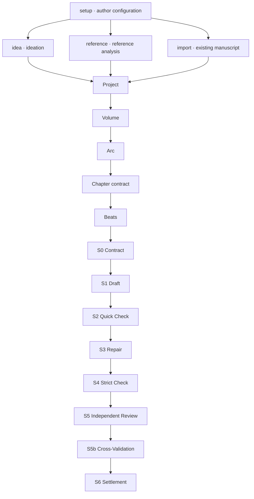

# CanonLoom

> A command-driven, author-controlled, auditable workflow for long-form fiction.

[](CHANGELOG.md)
[](LICENSE)
[](https://www.python.org/downloads/)
[](https://github.com/Liyuk/canonloom/actions/workflows/ci.yml)

[中文 README](README.md)

**Site and docs:** [https://liyuk.github.io/canonloom/](https://liyuk.github.io/canonloom/) (English landing: [/en/](https://liyuk.github.io/canonloom/en/))

Version: `0.2.1` · [Changelog](CHANGELOG.md)

CanonLoom is not a GUI writing application and not a black box that claims to generate an entire novel from one prompt. It turns novel production into inspectable, resumable tasks: ideation, reference analysis, planning, chapter contracts, beats, bounded context, drafting, revision, review, and settlement.

The author runs simple commands. Codex, Claude Code, or another file-capable agent performs the creative work. Python handles deterministic validation, indexing, provenance, run records, repair plans, and stage gates.

## What you actually get

- **Files are the state.** The author runs `init`, `setup`, `idea`, and `continue`. The agent reads `tasks/current.md` and writes into the agreed directories.
- **Canon waits for approval.** Ideas, candidates, drafts, review findings, and narrative-state proposals stay in a proposal layer. A draft reaches `manuscript/` only with an S6 approval file.
- **S0–S6 stage gates.** Contract, draft, quick check, repair, strict check, independent review, cross-validation, and settlement run in order.
- **Planning from large to small.** `planning` walks project → volume → arc → chapter contract → beats. A lower level carries out a decision the level above has already accepted.
- **Deterministic checks in the standard library.** Python 3.9+ and no third-party packages: validation, indexes, SHA-256 source fingerprints, diagnosis, and repairs that touch only structure.
- **Codex and Claude Code can both take the handoff.** `AGENTS.md` and `CLAUDE.md` are the entry points. Protocol keys stay English; prose follows `intent/author-setup.json`.

## Pipeline

The names below are the commands and stages in this repository. `idea`, `reference`, and `import` are parallel entries. Accepted intent then enters planning.



A chapter normally runs S0 → S1 → S2 → S3 → S4 → S5 → S5b → S6. Blocking findings at S4, S5, or S5b return to S3 or a human decision. Artifacts and return rules are in [Architecture](#architecture); the full protocol is in [Strong S0–S6 constraints](docs/strong-constraints.md).

## Quick start

Requirements: Python 3.9+. No third-party dependencies are required.

```sh
git clone https://github.com/Liyuk/canonloom
cd canonloom

./bin/canonloom init ~/my-novel --name "My Novel" \
  --language en-US --genre "speculative mystery" \
  --audience "adult readers" --pov close-third
./bin/canonloom --root ~/my-novel setup
./bin/canonloom --root ~/my-novel setup --confirm
./bin/canonloom --root ~/my-novel idea
./bin/canonloom --root ~/my-novel continue
```

Initialization intentionally separates author-confirmed configuration from AI recognition:

```text
author confirmation → intent/author-setup.json
AI recognition      → intent/ai-recognition.json
style constraints   → intent/style-profile.json
then                → idea / planning / work
```

AI recognition is a proposal layer. It does not silently promote facts into `canon/`.

## Everyday commands

```sh
./bin/canonloom --root ~/my-novel status       # Where am I?
./bin/canonloom --root ~/my-novel continue     # Follow next_action
./bin/canonloom --root ~/my-novel diagnose     # What is structurally wrong?
./bin/canonloom --root ~/my-novel repair       # Repair safe structural issues
./bin/canonloom --root ~/my-novel upgrade      # Upgrade an older project to the current structure
./bin/canonloom --version                      # Show framework version
./bin/canonloom --root ~/my-novel state report # Summarize optional narrative state
./bin/canonloom --root ~/my-novel state validate # Validate events, knowledge, and reveals
./bin/canonloom advanced                       # Show Agent/maintainer tools
```

Run the minimal end-to-end smoke test with:

```sh
examples/minimal-project/smoke.sh
```

Creation and analysis entry points include `setup`, `idea`, `reference`, `import`, `planning`, `work`, `characters`, `world`, `research`, `revision`, and `review`.

Authors do not need to learn `gate`, `context`, `handoff`, or `artifact-check`. These commands remain available for agents and maintainers; run `canonloom advanced` to see the complete list.

## Why it exists

Long fiction usually breaks between chapters: motivations drift, timelines contradict each other, unapproved assumptions enter the manuscript, context grows without control, and review comments never become concrete repair work.

CanonLoom uses a strict separation:

```text
an idea is not canon
a candidate is not a decision
a draft is not a manuscript
a review finding is not a story fact
unapproved memory is not active memory
```

Important changes should be traceable to author intent, a chapter contract, a selected option, bounded evidence, review findings, and explicit approval.

## Architecture

```text
author intent
      ↓
project / volume / arc / chapter contract / beats
      ↓
bounded context package + provenance
      ↓
draft → quick validation → repair plan
      ↓
strict validation → independent review → optional cross-validation
      ↓
author approval → settlement → manuscript + state settlement trace
```

The production protocol is S0–S6:

```text
S0 Contract
  ↓
S1 Draft → S2 Quick Check → S3 Repair
  ↓
S4 Strict Check → S5 Independent Review → S5b Cross-Validation
  ↓
S6 Human-Approved Settlement
```

Stages cannot be skipped. Without an explicit S6 approval, a draft is not promoted to `manuscript/`; narrative state is not silently promoted to canon.

## Recommended runtime: one model plus Python

The default recommendation is one primary model for ideation, planning, drafting, revision, and review, with Python handling deterministic work. This preserves creative continuity and reduces duplicated context and token synchronization.

Multiple models remain possible for isolated high-risk review, but their reports should be compared without merging hidden or mutable memory.

## Language policy

CanonLoom separates the language of the machine protocol from the language of the novel:

- JSON keys, enum values, commands, paths, and stage IDs remain stable English identifiers;
- repository instructions may be bilingual;
- prose, author intent, and human-facing review explanations follow `intent/author-setup.json`;
- an agent may explain decisions in the author's preferred language, but must preserve paths, schemas, and approval states.

See [docs/language-policy.md](docs/language-policy.md).

## Recovery and observability

Each fresh verification run gets its own manifest:

```text
runs/<work-id>/<run-id>/manifest.json
```

It can record stage, runtime strategy, tool calls, input/output tokens, latency, retries, and events. Context packages and indexes record SHA-256 source fingerprints.

```sh
./bin/canonloom --root ~/my-novel retry S0 --work-id chapter-001 --reason "revision needs a fresh pass"
./bin/canonloom --root ~/my-novel record --stage S2 --model my-model \
  --input-tokens 10000 --output-tokens 1500 \
  --latency-ms 4000 --retries 0
```

`diagnose → repair → diagnose` only repairs safe structure, configuration, and task artifacts. It does not rewrite canon, manuscript prose, review judgments, or author approvals. `upgrade` is the explicit entry point for older projects and currently performs the same safe migrations.

## Runtime compatibility

CanonLoom is designed for Codex, Claude Code, OpenCode, and other agents that can read and modify local files. The portable layer is Markdown, JSON, schemas, contracts, reports, and traces. Runtime-specific instructions live in `AGENTS.md`, `CLAUDE.md`, or an adapter layer.

Apps without local filesystem and Terminal access can still analyze uploaded artifacts, but cannot reliably maintain project state or run gates.

## Public-repository checklist

Before publishing a project based on CanonLoom:

- include a clear license and versioning policy;
- include a small original example project;
- document supported Python versions and runtime assumptions;
- add contribution and issue templates if accepting outside users;
- keep novels, private keys, unauthorized reference text, and sensitive logs out of Git;
- explain what the agent may write and where author approval is required.

Run the repository checks before release:

```sh
python3 -m py_compile scripts/*.py
python3 -m unittest discover -s tests -q
python3 scripts/public_check.py --root .
git diff --check
```

## Documentation

- [Initialization protocol](docs/en/initialization.md)
- [Workflow overview](docs/workflow.md)
- [Architecture](docs/architecture.md)
- [Strong S0–S6 constraints](docs/strong-constraints.md)
- [Terminal, API, and App usage](docs/en/terminal-and-apps.md)
- [Runtime adapters](docs/runtime-adapters.md)
- [Style Profile](docs/style-profile.md)
- [Benchmark and comparison notes](docs/en/benchmark.md)
- [Narrative state](docs/en/narrative-state.md)
- [Community and paper review](docs/research-review.md)
- [0.2.0 paper outline](docs/paper-0.2.0/outline.md)
- [0.2.0 full paper draft](docs/paper-0.2.0/paper.md)
- [Iteration roadmap](docs/iteration-roadmap.md)

## Scope

CanonLoom provides executable workflow conventions, file protocols, validators, gates, and audit traces. Model calls, literary judgment, and final canon approval remain the responsibility of the connected agent and the author.

This is not an AI-removal project; it is an AI-decoupling project. The agent handles ideation, planning, writing, and explanation; Python handles deterministic validation, stage transitions, provenance, and audit records; the author owns durable configuration, selection, and final approval. AI output remains a candidate or finding until explicitly approved.

## License

MIT — see [LICENSE](LICENSE).

See [CONTRIBUTING.md](CONTRIBUTING.md) and [SECURITY.md](SECURITY.md) for contribution and security guidance.
